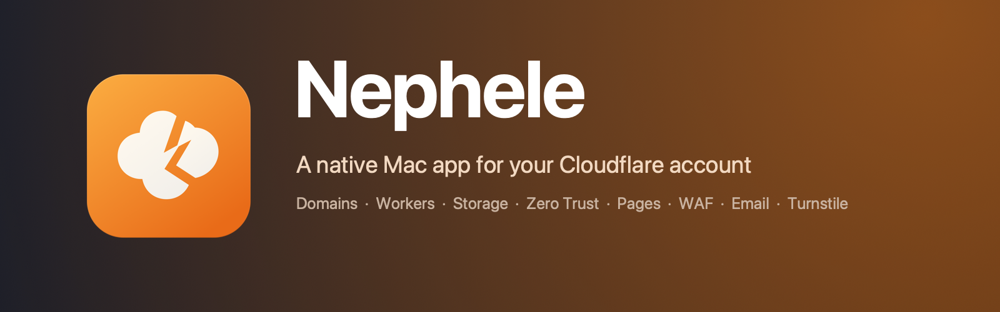
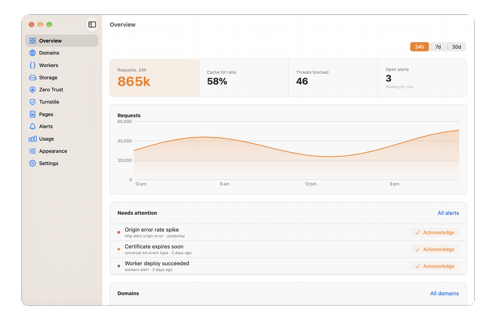
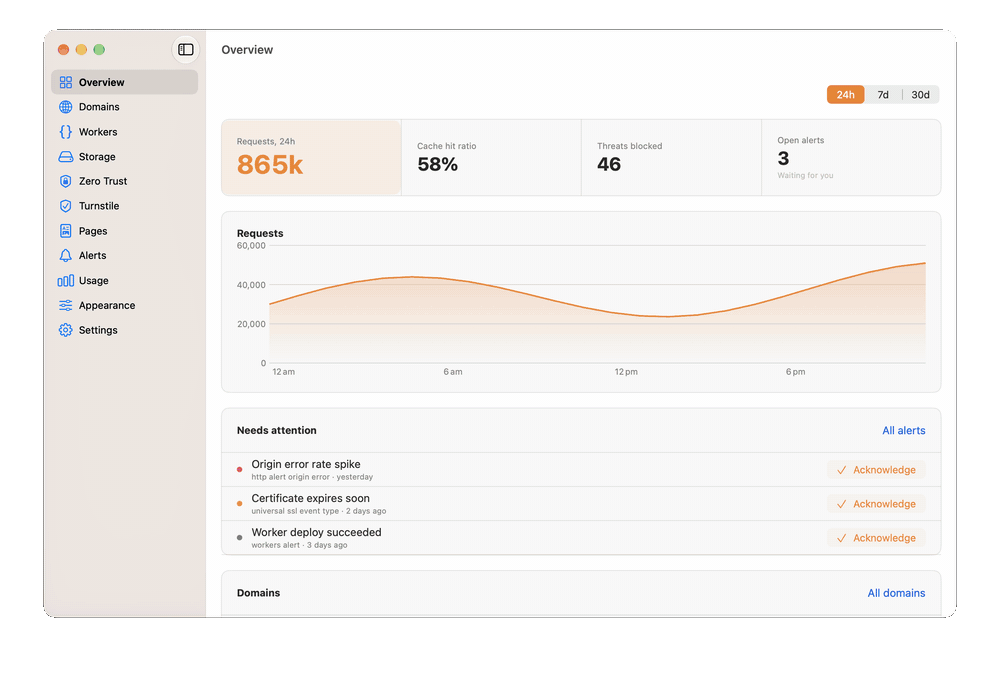

<p align="center"></p>

<p align="center">
  <a href="https://github.com/Ol775/nephele/releases/latest"></a>
  
  
  <a href="LICENSE"></a>
  
</p>

<p align="center"><b>Domains, DNS, Workers, storage, Zero Trust, Pages, WAF rules, email forwarding and Turnstile in one fast, native Mac app.</b><br>No browser tab, no Electron, no telemetry. Pure Swift and SwiftUI.</p>

<p align="center"></p>

> [!NOTE]
> **Beta.** Nephele is new. Everything that *reads* from Cloudflare is covered by tests; the actions that *change* things (DNS, Workers, storage, WAF, email and so on) have been tested against recorded responses but not yet against a live account. Try changes on a throwaway domain first, and please [report anything odd](https://github.com/Ol775/nephele/issues/new/choose). See [Known issues](#known-issues).
>
> An independent project, not affiliated with or endorsed by Cloudflare. Cloudflare is a trademark of Cloudflare, Inc.

## What it does

| | |
|---|---|
| **Overview** | Requests, cache hit ratio, threats and open alerts for your account, with a 24 h / 7 d / 30 d chart. |
| **Domains and DNS** | Every zone, filterable. Add, edit, proxy or delete DNS records with validation and confirmation. |
| **Per-domain settings** | SSL/TLS mode, Always use HTTPS, minimum TLS, security level, development mode, cache purge (by URL or everything). |
| **Firewall (WAF)** | Custom rules: list, add, turn on or off, delete. Anything that goes live asks first. |
| **Email Routing** | Forwarding rules to your verified addresses: add, turn on or off, delete. |
| **Workers** | Settings, variables, write-only secrets, routes, custom domains, cron triggers, versions with deploy and rollback, a code editor, live logs, templates. |
| **Storage** | Workers KV, D1 (with a SQL console that asks before anything changes data) and R2. |
| **Zero Trust** | Tunnels, Access applications, service tokens (secret shown once) and Gateway rules. |
| **Turnstile** | Widgets: create (secret shown once), list, delete. |
| **Pages** | Projects and deployments: retry, roll back, delete. |
| **Alerts and usage** | Notifications and a menu bar item for certificate, origin, usage and deploy alerts; usage against Free-plan allowances. |
| **Appearance** | Light, dark or system; accent colour, density, fonts, corner radius, sidebar layout. |

<p align="center"></p>

## Install

**Download:** grab `Nephele-x.y.z.dmg` from the [latest release](https://github.com/Ol775/nephele/releases/latest), open it and drag Nephele to Applications.

**Homebrew:**

```sh
brew install --cask Ol775/tap/nephele
```

**From source** (Xcode 26 or later and [XcodeGen](https://github.com/yonaskolb/XcodeGen)):

```sh
brew install xcodegen
git clone https://github.com/Ol775/nephele && cd nephele
xcodegen generate
xcodebuild -scheme Nephele -configuration Release -destination 'platform=macOS' build
```

> [!IMPORTANT]
> Nephele is signed ad hoc, not notarized (that needs a paid Apple Developer ID). If you download the DMG, macOS blocks the first launch: open **System Settings → Privacy & Security** and choose **Open Anyway**, or run `xattr -dr com.apple.quarantine /Applications/Nephele.app`. Homebrew and in-app updates skip this step. Details in [docs/getting-started.md](docs/getting-started.md).

## Get started in two minutes

1. In Cloudflare, go to **Profile → API Tokens → Create Token** and start with read-only permissions (see [docs/permissions.md](docs/permissions.md)).
2. Open Nephele and paste the token. It goes into your Keychain and nowhere else.
3. Add Edit permissions later, only for the areas where you want to make changes. Missing permissions never break the app: the screen that needs one tells you which.

**Want to look around first?** Run the demo with built-in sample data. It never touches the network or your Keychain:

```sh
/Applications/Nephele.app/Contents/MacOS/Nephele --demo
```

## Built to be safe with your account

- **Your token stays in the macOS Keychain.** It is only ever sent to `api.cloudflare.com`.
- **Nothing destructive happens in one click.** Deletes name the target; the dangerous ones (Workers, buckets, Pages projects, tunnels, tokens) make you type the name. Changes that can take a site down (SSL mode, WAF rules, purging everything) explain the risk first.
- **Secrets are write-only or shown once.** Worker secrets are never read back; service-token and Turnstile secrets appear once at creation, are never stored, and are kept out of logs and error text.
- **Read-only until you say otherwise.** Without an Edit permission the controls switch off and say what to add.
- **No analytics, no telemetry, no accounts.** The only other network request is the update check against this repository's GitHub releases.
- **Signed updates.** In-app updates install only if an Ed25519 signature made offline verifies, so even a hijacked GitHub account cannot push one. See [SECURITY.md](SECURITY.md).

## Updates

Nephele checks this repository's releases at launch (switch it off in **Settings → Updates**) and shows an **Update** button when a newer signed version exists. One click downloads it, verifies the signature, checksum, bundle identifier and code signature, swaps it in and relaunches. The previous version is kept as a backup and restored if anything fails.

## Documentation

| | |
|---|---|
| [Getting started](docs/getting-started.md) | Install, first launch, creating a token, the demo |
| [Permissions](docs/permissions.md) | Exactly which token permission each screen needs |
| [Features](docs/features.md) | What every screen does and which actions ask first |
| [Help and troubleshooting](docs/help.md) | Common problems and how to fix them |
| [Roadmap](ROADMAP.md) | What is planned, and what needs a decision |
| [Security](SECURITY.md) | Threat model, update trust model, how to report a vulnerability |
| [Privacy](PRIVACY.md) | What is stored and what is sent |
| [Contributing](CONTRIBUTING.md) | Building, testing and sending a pull request |
| [Changelog](CHANGELOG.md) | What changed in each release |
| [Architecture](docs/architecture.md) | How the code is laid out |

## Known issues

- **Writes are unverified live.** See the note at the top. Request and response shapes come from Cloudflare's OpenAPI spec and recorded fixtures.
- **Not notarized**, so the first launch of a downloaded copy needs the **Open Anyway** step. After an update, macOS may ask once to allow Keychain access: choose **Always Allow**.
- **WAF rules with extra options** (skip rules, custom block pages, rate limits) are shown but can't be toggled here, because Nephele would drop the options it can't display. Change those in the dashboard.
- **The icon is a concept.** A hand-tuned 16 px version is still to do.
- **The name and logo have not been legally cleared.** Search the UK IPO and USPTO registers before relying on them commercially.

## Licence

MIT. See [LICENSE](LICENSE).
